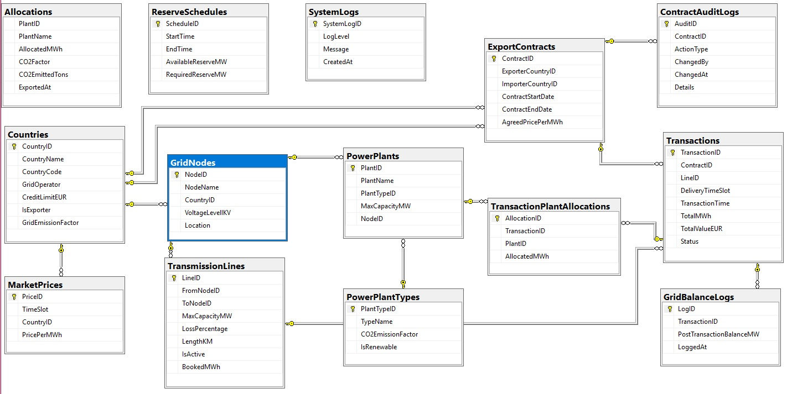

# GERDSS – German Energy Export Decision Support System

Relationale Datenbank in SQL Server, die entscheidet, ob eine Stromlieferung von Deutschland ins Ausland zulässig ist, und jede Buchung nachvollziehbar protokolliert.
Abschlussprojekt im Modul SQL Server (Weiterbildung Data Analytics, alfatraining, August 2026). Konzeption und Umsetzung: Aileen Hertel.

## Fragestellung

Deutschland erzeugt aus Wind und Sonne zeitweise mehr Strom, als im Inland gebraucht wird. Der Überschuss kann an Nachbarländer verkauft werden, aber nur, wenn drei Bedingungen erfüllt sind:

1. Die Leitung an der Grenze hat im gewünschten Zeitfenster noch freie Kapazität.
2. Das Käuferland bleibt mit dem Auftragswert innerhalb seines Kreditrahmens.
3. Im deutschen Netz bleibt genug Regelreserve übrig.

Gesucht war ein System, das diese Prüfung zuverlässig in der Datenbank selbst durchführt, statt sie einer Anwendung zu überlassen.

## Vorgehen

- **Datenmodell:** 14 normalisierte Tabellen für Länder, Verträge, Marktpreise, Netzknoten, Leitungen, Kraftwerke, Reservefahrpläne, Lieferungen und Protokolle.
- **Regeln in der Datenbank:** Jede Lieferung entsteht ausschließlich über eine gespeicherte Prozedur. Sie prüft die drei Bedingungen nacheinander und bucht erst dann, in einer Transaktion. Danach wird die Menge nach Merit Order auf die Kraftwerke verteilt, also die mit dem niedrigsten CO2-Ausstoß zuerst.
- **Nachvollziehbarkeit:** Trigger schreiben die gebuchte Leitungskapazität fort, geben sie bei Storno wieder frei und protokollieren Vertragsänderungen. Gelöscht wird nie, storniert wird über den Status.
- **Auswertung:** Sichten zu Kreditauslastung je Land, Netzkapazität, CO2-Bilanz, Reservelage und Potenzialmärkten. Das sind Länder ohne Netzanbindung oder ohne bisherige Lieferung.
- **Rechte:** Drei Rollen mit abgestuften Rechten. Mit Row Level Security sieht ein nationaler Netzbetreiber nur die Lieferungen seines eigenen Landes.
- **Externe Optimierung:** Ein Python-Programm wählt Kraftwerke aus und verteilt die Liefermenge. Das Ergebnis kommt als CSV per BULK INSERT zurück und wird über dieselbe Prüfung gebucht.

## Ergebnis

- Ungültige Lieferungen werden abgelehnt, mit dem konkreten Grund (z. B. „Stufe 2 – Finanzprüfung fehlgeschlagen“ mit Auftragswert und freiem Kreditrahmen). Gültige werden vollständig gebucht oder gar nicht.
- Jede Buchung, jeder Storno und jede Vertragsänderung ist im Protokoll nachvollziehbar.
- Die Sichten beantworten direkt Fragen wie: Welche Leitungen sind ausgelastet? Wie viel CO2 spart der Export? In welche Länder könnte geliefert werden, sobald eine Leitung besteht?
- Zu jedem Objekt gibt es ein Testskript, das Erfolgsfall und Fehlerfälle durchspielt.

## Umfang

| Objekt | Anzahl |
| --- | --- |
| Tabellen | 14 |
| Fremdschlüssel / CHECK / UNIQUE | 14 / 22 / 8 |
| Sekundärindizes | 9 + 1 räumlicher Index |
| Sichten | 7 |
| Funktionen | 5 (4 Skalar-, 1 Tabellenwertfunktion) |
| Gespeicherte Prozeduren | 3 |
| Trigger | 5 |
| Rollen / Sicherheitsrichtlinie | 3 / 1 |

**Techniken:** T-SQL, Transaktionen mit COMMIT/ROLLBACK, TRY…CATCH, CTE, CURSOR, SELF JOIN und OUTER JOIN, GROUP BY/HAVING, räumliche Daten (GEOGRAPHY), Row Level Security, BULK INSERT, Backup/Restore; Python mit pandas und NumPy.

## Aufbau

| Ordner | Inhalt |
| --- | --- |
| `sql/001-DB-Create-Scripts` | Datenbank, Tabellen, Indizes, Einschränkungen, Stammdaten, räumliche Daten |
| `sql/002-Abfragen und View` | Sichten und Vergleich INNER/OUTER JOIN |
| `sql/003-StoredFunctions` | Funktionen mit Testskript |
| `sql/004-StoredProcedures` | Buchungsprozedur und CSV-Import mit Testskripten |
| `sql/005-DML-Trigger` | Trigger mit Testskript |
| `sql/005-LOGN-USER-ROLE` | Anmeldungen, Rollen, Row Level Security |
| `sql/006-BackUp` | Backup-Prozedur |
| `sql/007-Datenimport` | Export für die Optimierung, BULK INSERT der Ergebnisse |
| `python` | Externe Optimierung (eigene README) |
| `docs` | Projektdokumentation (PDF) und Datenbankdiagramm |

## Ausführen

Die Skripte in `sql` der Nummer nach in SQL Server Management Studio ausführen, beginnend mit `001-001`. Jedes Skript endet mit einer Kontrollabfrage.
Die Kennwörter in `005-001` sind Platzhalter für eine lokale Testumgebung.
