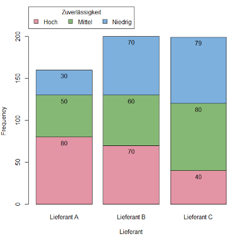
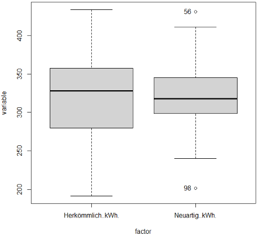
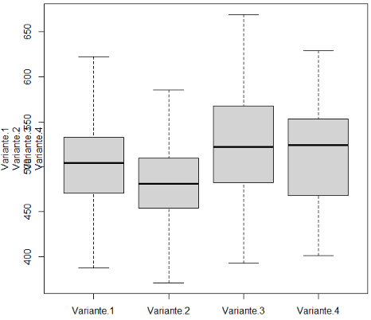
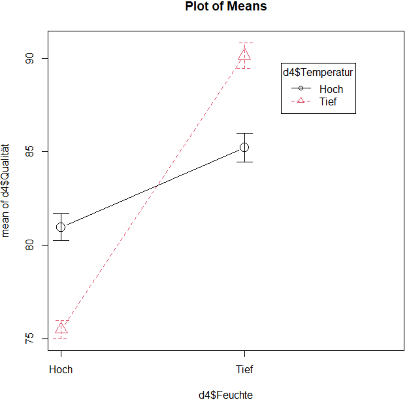

# Statistische Auswertung – Techno GmbH

Vier Fragen eines Industrieunternehmens, beantwortet mit Hypothesentests in R. Jedes Verfahren ist aus Fragestellung, Skalenniveau und Datenlage hergeleitet, die Voraussetzungen sind geprüft, und jedes Ergebnis endet in einer klaren Antwort für das Unternehmen.
Projektarbeit im Modul „Statistik und Datenanalyse“ (alfatraining, Juli 2026). Das Modul habe ich „mit ausgezeichnetem Erfolg“ abgeschlossen. Signifikanzniveau 5 %.

Die vollständige Auswertung mit allen Tests und Abbildungen liegt in [`docs/Statistik_Projektarbeit_Techno_GmbH.pdf`](docs/Statistik_Projektarbeit_Techno_GmbH.pdf).

## Fragen und Ergebnisse

| Frage | Antwort |
| --- | --- |
| Unterscheiden sich die drei Lieferanten in der Zuverlässigkeit ihrer Produkte? | **Ja.** Lieferant A ist am zuverlässigsten, C am wenigsten (Chi²-Test, p < 0,1 %). |
| Ändert sich die Qualitätsverteilung, wenn nur noch Lieferant A liefert? | **Ja, nach oben.** 50 % statt 34 % hohe Qualität (Chi²-Anpassungstest, p < 0,1 %). |
| Senkt ein neues Produktionsverfahren den Energieverbrauch? | **Nein.** Kein nachweisbarer Rückgang, der Verbrauch ist nur gleichmäßiger (Welch-t-Test, p = 59 %). |
| Welche von vier Werkzeugvarianten hält am längsten? | **Variante 3.** Sie ist als einzige signifikant besser als V1 und V2. V4 verbessert V1 und ist von V3 nicht unterscheidbar. |
| Welche Faktoren beeinflussen die Qualität eines Klebeprozesses? | **Nur die Feuchte** und ihr Zusammenspiel mit der Temperatur. Beste Qualität bei niedriger Feuchte und niedriger Temperatur (dreifaktorielle ANOVA). |

## Vorgehen

1. **Verfahren wählen:** Skalenniveau und Aufbau der Daten bestimmen den Test, z. B. gepaart oder unabhängig.
2. **Voraussetzungen prüfen:** Normalverteilung (Anderson-Darling, Shapiro-Wilk), gleiche Streuung (Levene) und Ausreißer (Grubbs). Ist eine Voraussetzung verletzt, kommt das passende robuste Verfahren zum Einsatz, z. B. Welch statt Student.
3. **Testen und absichern:** Hypothesentest, dazu ein Rangtest als Gegenprobe und Effektstärken, um zu zeigen, wie groß ein Unterschied wirklich ist.
4. **Antworten:** Ergebnis in einem Satz für das Unternehmen. Dazu gehört, was ein nicht signifikantes Ergebnis bedeutet und was nicht.

## Abbildungen

| | |
| --- | --- |
|  |  |
| Zuverlässigkeit je Lieferant | Energieverbrauch: herkömmlich vs. neu |
|  |  |
| Standzeit je Werkzeugvariante | Wechselwirkung Feuchte × Temperatur |

## Methoden

Chi²-Unabhängigkeits- und Anpassungstest · Welch-t-Test · gepaarter t-Test · Mann-Whitney-U / Wilcoxon · Welch-ANOVA mit Games-Howell · dreifaktorielle ANOVA mit Wechselwirkungen · Effektstärken (Cramér's V, Cohen's d, η²) · Teststärke

**Werkzeuge:** R mit R Commander
