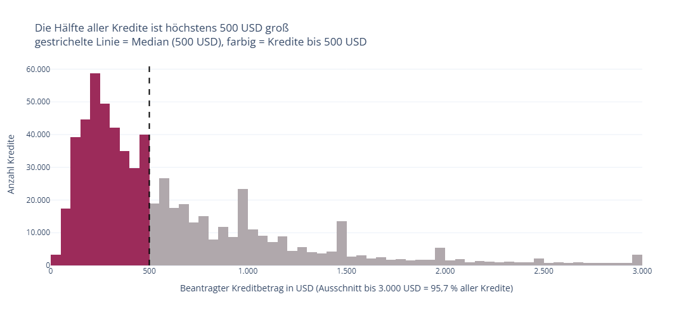
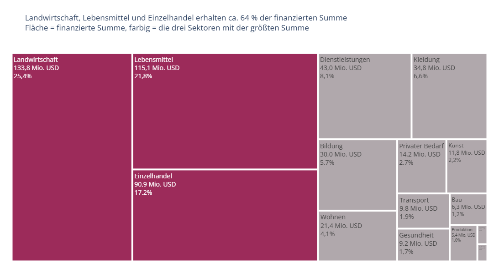
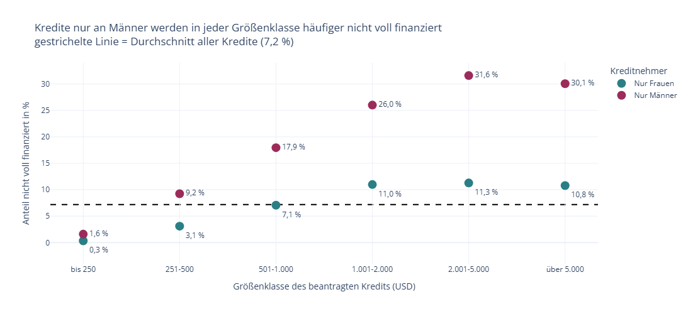
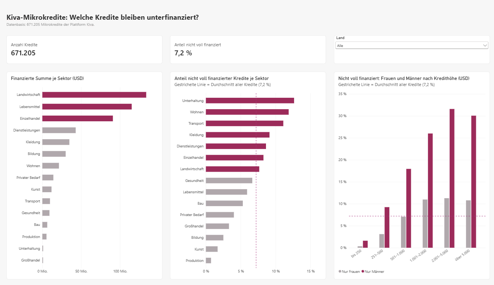

# Kiva-Kredite: Explorative Datenanalyse und Dashboard

Analyse von 671.205 Mikrokrediten der Plattform Kiva mit Python: Welche Kredite erreichen ihren beantragten Betrag und welche nicht? Dazu ein interaktives Dashboard, das sich nach Land und Kreditnehmer-Gruppe filtern lässt.
Abschlussprojekt im Modul Data Analytics (alfatraining, Oktober 2026), aufgebaut nach CRISP-DM.

**Notebook:** [`Kiva_Explorative_Datenanalyse.ipynb`](Kiva_Explorative_Datenanalyse.ipynb)

## Fragestellung

Kiva vermittelt Kleinkredite, die von vielen privaten Geldgebern gemeinsam finanziert werden. 7,2 % der Kredite erreichen ihren beantragten Betrag nicht.
Untersucht wurde, was diese Kredite von den voll finanzierten unterscheidet: Sektor, Kredithöhe oder die Kreditnehmer.

## Vorgehen

1. **Daten kennenlernen:** Struktur, Datentypen und fehlende Werte. Ein scheinbar fehlender Ländercode entpuppte sich als Namibia („NA“), das pandas als „leer“ einliest.
2. **Bereinigung:** Fehlende Angaben als *Unknown* gekennzeichnet statt gelöscht, damit keine Beträge aus den Summen fallen. Doppelte Zeilen, Ausreißer und unplausible Werte geprüft und mit Begründung behalten. Neue Spalten für Finanzierungsstatus, Größenklasse und Kreditnehmer-Gruppe.
3. **Analyse:** Verteilungen einzelner Spalten, dann Zusammenhänge zwischen Finanzierung und Sektor, Kredithöhe, Geschlecht und Land.
4. **Gegenprobe:** Der Unterschied zwischen Frauen und Männern wurde innerhalb gleicher Größenklassen, Sektoren und Länder geprüft, damit er nicht nur an der Kredithöhe liegt.
5. **Dashboard:** Dash-App mit zwei verknüpften Grafiken und Filtern für Land und Kreditnehmer-Gruppe.

## Ergebnisse

- **Kredithöhe:** Die meisten Kredite sind klein. Der Median liegt bei 500 USD, einzelne sehr große Kredite heben den Mittelwert auf 842 USD.
- **Sektoren:** Landwirtschaft, Lebensmittel und Einzelhandel erhalten zusammen rund 64 % der finanzierten Summe von 527,6 Mio. USD.
- **Finanzierung:** Größere Kredite und die Sektoren Unterhaltung, Wohnen und Transport verfehlen ihren Betrag am häufigsten.
- **Kreditnehmer:** Kredite nur an Männer bleiben dreimal so oft unter dem beantragten Betrag wie Kredite nur an Frauen (15,6 % gegenüber 4,7 %). Das gilt in jeder Größenklasse, in allen 15 Sektoren und in 9 der 10 größten Länder.

| | | |
| --- | --- | --- |
|  |  |  |
| Verteilung der Kreditbeträge | Finanzierte Summe je Sektor | Nicht voll finanziert, nach Größenklasse |

## Power-BI-Dashboard

Die Ergebnisse der Python-Analyse habe ich zusätzlich als Dashboard in Power BI Desktop umgesetzt. Alle Diagramme lassen sich nach Land filtern.



- **Power Query:** CSV-Import mit Trennzeichen `#`, leere Felder als *Unknown*, neue Spalten für Finanzierungsstatus, Größenklasse, Kreditnehmer-Gruppe und deutsche Sektornamen.
- **DAX:** Measures für die Anzahl der Kredite und den Anteil nicht voll finanzierter Kredite.
- **Gestaltung:** Hervorgehoben sind nur die Werte, auf die es ankommt. Die gestrichelte Linie zeigt den Durchschnitt aller Kredite (7,2 %).

**Datei:** [`powerbi/Kiva_PowerBI.pbix`](powerbi/Kiva_PowerBI.pbix) (öffnen mit Power BI Desktop)

## Grenzen

Die Analyse beschreibt Zusammenhänge, keine Ursachen. Ohne Kredit-Nummer lassen sich doppelte Zeilen nicht sicher einordnen. Kredithöhe, Sektor und Land wurden einzeln kontrolliert, nicht alle gleichzeitig.

## Ausführen

Der Datensatz ist nicht im Repository enthalten. Er basiert auf dem öffentlichen [Kiva-Datensatz bei Kaggle](https://www.kaggle.com/datasets/kiva/data-science-for-good-kiva-crowdfunding) und lag im Kurs als `data_abschlussprojekt.csv` vor (Trennzeichen `#`). Die Datei gehört in den Ordner `data/`.

```
pip install -r requirements.txt
jupyter notebook Kiva_Explorative_Datenanalyse.ipynb
```

**Werkzeuge:** Python, pandas, Plotly Express, Dash, Jupyter, Power BI Desktop (Power Query, DAX)
